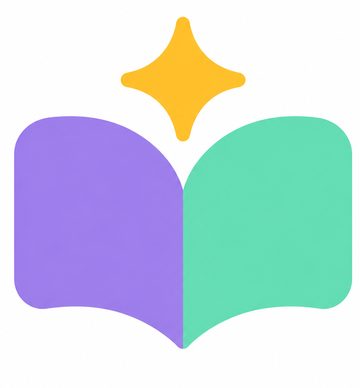
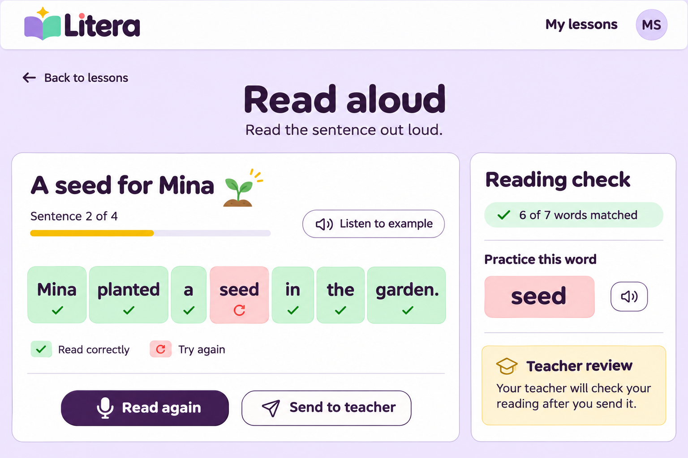
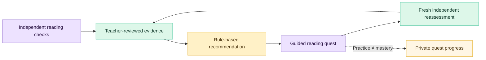

<div align="center">
  

  # Litera

  **A clearer path from reading checks to the next lesson.**

  Teacher-guided, adaptive English reading support for Grade 3 learners in Davao City, Philippines.

  <p>
    
    
    
    
  </p>

  [Features](#-features) · [Reading journey](#-the-reading-journey) · [Project board](#-project-board) · [Run locally](#-run-locally) · [References](#-references)
</div>

---

## Why Litera?

Two learners can both need reading support for different reasons: one may struggle to blend sounds, while another can read words but not understand a passage. Litera helps teachers **identify the specific difficulty and choose targeted practice** rather than relying on a single overall reading score.

In the June 2026 beginning-of-school-year CRLA results, **45% of assessed learners in Davao City** were classified as *Low- or High-Emerging* readers, as reported by [EDCOM II](https://edcom2.gov.ph/edcom-2-nearly-half-of-learners-in-davao-region-struggle-with-reading/). This is **not** a Grade 3 English-only statistic and does not validate Litera's own assessments.

## ✨ Features

| Reading checks | Personalized practice | Teacher oversight |
| :--- | :--- | :--- |
| 🔤 **Phonics** — letter sounds and blending | 🧭 **Adaptive recommendations** — explainable, rule-based next activities | 👩‍🏫 **Evidence review** — teacher-confirmed judgments |
| 🎤 **Oral reading** — recorded passage reading and word accuracy | 💡 **Guided hints** — step-by-step support during practice | 📋 **Learner overview** — separate skill results and review needs |
| 📖 **Comprehension** — questions about text | 🗺️ **Reading quests** — private progress and gentle rewards | 🔁 **Reassessment** — fresh independent checks |

Guided quests include optional English audio in Word Village, Story Forest, and Meaning Mountain. Speech transcription gives the teacher an advisory preview. Teacher validation determines the assessment result.

### 🖼️ Interface preview

<div align="center">
  
  <sub>Concept UI from the hackathon pitch; not a verified live screenshot. Word matches are advisory until teacher review.</sub>
</div>

## 🔄 The reading journey



### 🗺️ Reading Adventure

| 🌱 Word Village | 🌲 Story Forest | ⛰️ Meaning Mountain |
| :---: | :---: | :---: |
| Phonics and blending | Oral reading and rereading | Comprehension and text evidence |

Quest completion reflects **practice participation**, not confirmed reading mastery. Only qualifying independent assessments can change a learner's skill status.

## 📌 Project board

| ✅ Prototype foundation | 🧪 Verify before demo | 🗓️ Future work |
| :--- | :--- | :--- |
| Three separate reading checks | Latest branch integration | Secure teacher accounts |
| Teacher-reviewed evidence rules | Real browser/microphone testing | More approved reading passages |
| Rule-based learning recommendations | Hints, quest map and teacher view | Classroom evaluation with educators |

> **Project stage:** Hackathon prototype. The board describes the integrated app in this checkout. An independent evaluation of literacy outcomes is future work.

## 🚀 Run locally

**Requirements:** Windows 11, Python 3.11–3.12, Node.js 22.12+, Chrome or Edge. First-time installation/model downloads need internet access.

From the repository root, copy `.env.example` to `.env` if needed and set the existing sign-in and teacher credentials. Run the launcher from that same folder.

```powershell
.\Start-Litera.cmd
```

Open **http://127.0.0.1:8765** and use **fictional learner data** with consenting adult voices for recording demonstrations. The launcher builds `frontend/` and runs `backend/`. Guided spoken models use a local English system voice if available. Open **Practice** to try **Listen**, **Listen Slowly**, **Listen Again**, and **Stop**. Word Village also lets learners record and replay a short rehearsal within the current step.

See the [developer checklist](DEVELOPMENT.md#guided-practice-audio) for voice setup, browser testing, and adding teacher-recorded sound models.

## 🛠️ Tech stack

**Frontend:** React · TypeScript · Vite  
**Backend:** FastAPI · Python · SQLite  
**Speech:** Local `faster-whisper` transcription for teacher review  
**Recommendations:** Transparent, rule-based decision tree

## 📚 References

The following resources inform the **problem framing and instructional design**; they do not validate Litera's thresholds or effectiveness.

1. **EDCOM II (2026).** [Nearly half of learners in Davao Region struggle with reading](https://edcom2.gov.ph/edcom-2-nearly-half-of-learners-in-davao-region-struggle-with-reading/) — reported CRLA findings for Davao City and Region XI.
2. **DepEd (2025).** [ARAL-Reading Program Guidelines — Memorandum No. 064, s. 2025](https://www.deped.gov.ph/wp-content/uploads/DM_s2025_064r.pdf) — guidance on targeted reading support.
3. **IES / What Works Clearinghouse (2016; revised 2019).** [Foundational Skills to Support Reading for Understanding in Kindergarten Through 3rd Grade](https://ies.ed.gov/ncee/wwc/PracticeGuide/21).
4. **IES / What Works Clearinghouse (2010).** [Improving Reading Comprehension in Kindergarten Through 3rd Grade](https://ies.ed.gov/ncee/wwc/PracticeGuide/14).

---

<div align="center">
  <strong>Assess thoughtfully. Practice purposefully. Let teachers guide the next step.</strong>
  <br />
  <sub>Litera (formerly BasaBridge) · Educational prototype · Davao City, Philippines</sub>
</div>
