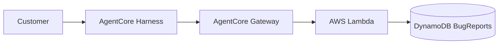

# Customer Support Chatbot with Amazon Bedrock

This project implements an AI-powered customer-support chatbot for a fictional online shop. Amazon Bedrock Flows classifies incoming messages and routes them to separate handlers for bug reports, platform questions, other requests, and unexpected classifier output.

The original project specification requires Amazon Bedrock Agents Classic for ticket creation. AWS closed Agents Classic to new customers on July 30, 2026, so the working ticket-creation path was migrated to Amazon Bedrock AgentCore Harness and Gateway. The original Bedrock Flow remains available for classification, routing, FAQ responses, automated Flow invocation, and managed Bedrock Evaluation.

## Results

| Evaluation | Result |
|---|---:|
| Bedrock Evaluation, LLM-as-a-judge correctness | **1.00** |
| Flow invocations used to create the JSONL dataset | **4/4 successful** |
| Local AgentCore Harness scenarios | **5/5 passed** |
| AgentCore Harness pass rate | **100%** |
| Failed AgentCore Harness scenarios | **0** |

## Architecture

### Amazon Bedrock Flow architecture


| Stage | Component | Responsibility |
|---|---|---|
| Input | FlowInputNode | Receives the customer's message |
| Classification | ClassifierPrompt | Returns `BUG_REPORT`, `PLATFORM_QUESTION`, or `OTHER_REQUEST` |
| Routing | RequestRouter | Routes the message using exact condition expressions |
| Bug-report path | BugTemporaryHandler | Collects the problem description, reproduction steps, and environment |
| Platform-question path | FAQPrompt | Answers questions using only the embedded FAQ |
| Other-request path | OtherRequestPrompt | Directs unsupported requests to human support |
| Fallback path | UnexpectedInputPrompt | Handles unexpected classifier output |
| Output | Separate Flow Output nodes | Terminates every routing path independently |

### AgentCore ticket-creation architecture

| Order | Component | Action |
|---:|---|---|
| 1 | Customer | Supplies the bug description, reproduction steps, and environment |
| 2 | AgentCore Harness | Collects and validates all required fields |
| 3 | AgentCore Gateway | Exposes and invokes the `create_bug_report` tool |
| 4 | Lambda | Generates a ticket ID and writes the bug report |
| 5 | DynamoDB | Persists the ticket in `BugReports-ef43ab20` |
The production-capable bug-report implementation uses the migration path below:



## Platform limitation and implementation adaptation

The original rubric requires an Amazon Bedrock Agents Classic node in the
bug-report Flow path. AWS closed Agents Classic to new customers on July 30,
2026, and this lab account cannot create an Agents Classic agent. The project
therefore implements the equivalent working ticket-creation capability with
Amazon Bedrock AgentCore Harness, AgentCore Gateway, Lambda, and DynamoDB.

The Bedrock Flow still implements classification, conditional routing, FAQ
handling, other-request handling, separate outputs, automated Flow tests, and
managed Bedrock Evaluation. Screenshots of the Agents Classic restriction and
the successful AgentCore ticket-creation path are included in the screenshots
directory.


## Classification and routing

The `ClassifierPrompt` returns exactly one of the following labels:

- `BUG_REPORT`
- `PLATFORM_QUESTION`
- `OTHER_REQUEST`

The `RequestRouter` Condition node uses exact string comparisons and sends each category to a distinct path. A fourth fallback path handles any unexpected classifier output.

The classifier uses deterministic inference settings:

- Temperature: `0`
- Top P: `0.1`
- Maximum output tokens: `20`

Flow details used by the automated test suite:

| Setting | Value |
|---|---|
| Flow name | `customer-support-chatbot-flow` |
| Flow ID | `DUFZ2DFEWH` |
| Input node | `FlowInputNode` |
| Alias | `v1` |
| Alias ID | `Q9X9W98JLK` |
| Associated version | Version 1 |

## Bug-report implementation

The Lambda-backed tool accepts these fields:

| Field | Description |
|---|---|
| `description` | Clear description of the technical problem |
| `stepsToReproduce` | Actions that reproduce the problem |
| `environment` | Browser, operating system, device, or other environment details |

The deployed Lambda supports both the original Agents Classic event structure and AgentCore Gateway's direct JSON tool input. Successful calls return a genuine `ticketId` and a status of `OPEN`, while DynamoDB stores the full bug-report record.

The working AgentCore implementation:

1. Collects all three required fields.
2. Asks concise follow-up questions for missing fields.
3. Calls the `create_bug_report` Gateway tool exactly once after the fields are complete.
4. Invokes the Lambda function through an IAM-authenticated AgentCore Gateway.
5. Persists the resulting ticket in the `BugReports-ef43ab20` DynamoDB table.
6. Returns only the real ticket ID and status produced by the tool.

## Platform-question path

The `FAQPrompt` embeds `online_shop_faq.md` and instructs the model to answer using only the supplied FAQ. It covers orders, shipping, delivery, returns, refunds, payments, products, accounts, support, security, and privacy.

If the FAQ does not explicitly contain the answer, the Flow returns the required fallback and directs the customer to:

```text
+1 (202) 555-0147
```

This prevents unsupported policies, prices, procedures, payment methods, and contact information from being invented.

## Other-request path

Messages outside the bug-report and platform-question categories are handled by a separate Prompt and Output node. The response politely explains that the chatbot cannot process the request and directs the customer to the human-support number without answering the unrelated question.

## Infrastructure deployment

Deploy the Lambda function, DynamoDB table, and tool IAM role:

```bash
aws cloudformation deploy \
  --template-file cloudformation-tool.yaml \
  --stack-name bug-report-tool-stack \
  --capabilities CAPABILITY_NAMED_IAM \
  --region us-east-1
```

Deploy the S3 bucket and Bedrock Evaluation role:

```bash
aws cloudformation deploy \
  --template-file cloudformation-testing.yaml \
  --stack-name bug-report-testing-stack \
  --capabilities CAPABILITY_NAMED_IAM \
  --region us-east-1
```

Install the Python dependency:

```bash
python -m pip install -r requirements.txt
```

## Automated Flow testing

`flow-tests.json` contains four scenarios covering all required Flow categories:

1. Bug report
2. Covered platform question
3. Uncovered platform question
4. Other request

Generate the Bedrock Evaluation BYOI dataset:

```bash
python generate-eval-dataset.py --enable-trace
```

Generation result:

```text
Successful Flow calls: 4/4
Failed Flow calls: 0/4
JSONL: output_eval_dataset.jsonl
```

Validate the generated JSONL:

```bash
python -m json.tool --json-lines output_eval_dataset.jsonl
```

The dataset was uploaded to:

```text
s3://udacity-agentic-engineer-c1-eval-140964999782/output_eval_dataset.jsonl
```

## Bedrock Evaluation

The managed evaluation uses Bring Your Own Inference because the Flow responses are precomputed in `output_eval_dataset.jsonl`.

| Setting | Value |
|---|---|
| Evaluation job | `flow-eval-run-2` |
| Evaluation type | Automatic: LLM as a judge |
| Evaluator model | `amazon.nova-pro-v1:0` |
| Inference source | `my-flow-app` |
| Metric | `Builtin.Correctness` |
| Prompts | 4 |
| Status | Completed |
| Correctness | **1.00** |

### Evaluation observations

The overall correctness score was `1.00`, with an average correctness score of `1.000` across all four prompts. This indicates that the Flow consistently routed each message to an appropriate path and produced responses aligned with their reference expectations.

The covered FAQ question returned the documented 30-day return policy. The uncovered cryptocurrency-payment question did not invent an answer and instead returned the required support-number fallback. The sponsorship request followed the independent other-request path and redirected the user to human support. The bug-report test correctly acknowledged the technical problem and requested the details needed for investigation without falsely claiming that the unavailable Classic Agent had created a ticket.

## AgentCore automated evaluation

Because Agents Classic is unavailable to this new AWS customer, the complete ticket-creation behavior was evaluated separately through the working AgentCore implementation.

The five deterministic scenarios verified:

- A complete bug report creates a DynamoDB ticket.
- A missing environment triggers a follow-up and creates a ticket after completion.
- Missing reproduction steps trigger a follow-up and create a ticket after completion.
- A problem description without sufficient details triggers follow-up questions without creating a ticket.
- An unrelated request does not invoke the bug-report tool.

Result:

```text
Passed: 5/5
Failed: 0/5
Pass rate: 100.0%
```

Detailed outputs are stored in:

- `evaluation-results/agentcore-eval-dataset.json`
- `evaluation-results/harness-evaluation-results.json`
- `evaluation-results/harness-evaluation-summary.md`

## AWS service availability and migration note

The project instructions target Amazon Bedrock Agents Classic. The AWS console reports that Agents Classic is no longer open to new customers starting July 30, 2026, and the lab account contains no Classic agents. Consequently, a new Classic Agent and its required Flow Agent node could not be created.

The project preserves the original Bedrock Flow for the three-path routing and managed Bedrock Evaluation requirements. The unavailable Classic Agent path is represented by `BugTemporaryHandler`, which collects the required details and never falsely claims ticket creation. The functional ticket-creation requirement is demonstrated through the recommended AWS migration: AgentCore Harness, IAM-authenticated Gateway, Lambda tool, and DynamoDB persistence.

The managed AgentCore Evaluation interface also required CloudWatch Transaction Search, but the Udacity-managed `voclabs` role could not perform `application-signals:StartDiscovery`. A local repeatable Harness evaluation was therefore used for the AgentCore path, while the original Bedrock managed Evaluation successfully completed for the Flow with a correctness score of `1.00`.

## Evidence

### Classification and routing

| Evidence | Screenshot |
|---|---|
| Complete Flow diagram | [bedrock_full_flow_diagram.png](screenshots/bedrock_full_flow_diagram.png) |
| Classifier and exact Condition expressions | [bedrock_classifier_and_conditions.png](screenshots/bedrock_classifier_and_conditions.png) |
| Complete classifier configuration view | [bedrock_classifier_and_conditions_full_page_view.png](screenshots/bedrock_classifier_and_conditions_full_page_view.png) |
| Flow input configuration | [bedrock_flow_input_configuration.png](screenshots/bedrock_flow_input_configuration.png) |
| Published Flow alias | [bedrock_flow_alias_v1.png](screenshots/bedrock_flow_alias_v1.png) |

### Platform and other-request paths

| Evidence | Screenshot |
|---|---|
| Embedded FAQ Prompt configuration | [bedrock_faq_prompt_configuration.png](screenshots/bedrock_faq_prompt_configuration.png) |
| Covered FAQ response | [03-faq-covered-test.png](screenshots/03-faq-covered-test.png) |
| Uncovered FAQ fallback | [04-faq-uncovered-test.png](screenshots/04-faq-uncovered-test.png) |
| Other-request response | [05-other-request-test.png](screenshots/05-other-request-test.png) |
| Incomplete bug-report response | [06-bug-incomplete-details-test.png](screenshots/06-bug-incomplete-details-test.png) |

### Lambda, DynamoDB, and AgentCore

| Evidence | Screenshot |
|---|---|
| Successful Lambda test | [01-lambda-test-success.png](screenshots/01-lambda-test-success.png) |
| DynamoDB record created | [dynamodb-record-success.png](screenshots/dynamodb-record-success.png) |
| Additional DynamoDB persistence evidence | [dynamodb_bug_report_persistence.png](screenshots/dynamodb_bug_report_persistence.png) |
| Successful AgentCore bug-report tool call | [agentcore_bug_report_success.png](screenshots/agentcore_bug_report_success.png) |
| AgentCore-created DynamoDB records | [agentcore_evaluation_dynamodb_records.png](screenshots/agentcore_evaluation_dynamodb_records.png) |
| Harness smoke test | [local_harness_smoke_test_success.png](screenshots/local_harness_smoke_test_success.png) |
| AgentCore evaluation: 5/5 passed | [agentcore_harness_evaluation_success.png](screenshots/agentcore_harness_evaluation_success.png) |

### Flow evaluation

| Evidence | Screenshot |
|---|---|
| Successful JSONL generation | [bedrock_flow_jsonl_generation_success.png](screenshots/bedrock_flow_jsonl_generation_success.png) |
| Testing-stack deployment | [bedrock_testing_stack_deployment_success.png](screenshots/bedrock_testing_stack_deployment_success.png) |
| Testing-stack outputs | [bedrock_testing_stack_outputs.png](screenshots/bedrock_testing_stack_outputs.png) |
| Dataset uploaded to S3 | [bedrock_evaluation_dataset_s3_upload.png](screenshots/bedrock_evaluation_dataset_s3_upload.png) |
| Evaluation job created | [bedrock_evaluation_job_created.png](screenshots/bedrock_evaluation_job_created.png) |
| Evaluation job completed | [bedrock_evaluation_job_completed.png](screenshots/bedrock_evaluation_job_completed.png) |
| Evaluation summary | [bedrock_evaluation_summary.png](screenshots/bedrock_evaluation_summary.png) |
| Correctness score of 1.00 | [bedrock_evaluation_correctness_1.png](screenshots/bedrock_evaluation_correctness_1.png) |
| Per-prompt evaluation details | [bedrock_evaluation_prompt_details.png](screenshots/bedrock_evaluation_prompt_details.png) |

### Service limitations

| Evidence | Screenshot |
|---|---|
| Agents Classic unavailable to new customers | [aws_agents_classic_unavailable.png](screenshots/aws_agents_classic_unavailable.png) |
| Agents Classic maintenance/migration notice | [aws-agents-classic-maintenance-blocker.png](screenshots/aws-agents-classic-maintenance-blocker.png) |
| AgentCore Transaction Search permission blocker | [agentcore-evaluation-transaction-search-blocked.png](screenshots/agentcore-evaluation-transaction-search-blocked.png) |

## Project files

| File | Purpose |
|---|---|
| `cloudformation-tool.yaml` | Deploys DynamoDB, Lambda, and the Lambda execution role |
| `cloudformation-testing.yaml` | Deploys the evaluation S3 bucket and Bedrock evaluation role |
| `create_bug_report.py` | Implements the backward-compatible bug-report tool |
| `flow-tests-template.json` | Starter test-suite template retained for reference |
| `flow-tests.json` | Completed Flow test suite covering every required path |
| `generate-eval-dataset.py` | Invokes the published Flow and writes BYOI JSONL |
| `output_eval_dataset.jsonl` | Precomputed responses submitted to Bedrock Evaluation |
| `evaluation-config.json` | Correctness metric, dataset, and evaluator configuration |
| `inference-config.json` | Precomputed inference-source configuration |
| `output-data-config.json` | Evaluation result S3 destination |
| `run-harness-evaluation.py` | Deterministic local AgentCore evaluation runner |
| `test-harness-invoke.py` | AgentCore Harness smoke test |
| `online_shop_faq.md` | Embedded fictional online-shop FAQ |
| `requirements.txt` | Python dependency specification |

## Submission note

AWS resources should remain deployed until the project has been reviewed and graded. Cleanup commands should only be run after grading because deleting the Flow, evaluation job, S3 objects, Lambda function, Gateway, Harness, or DynamoDB table would remove evidence needed to assess the submission.
