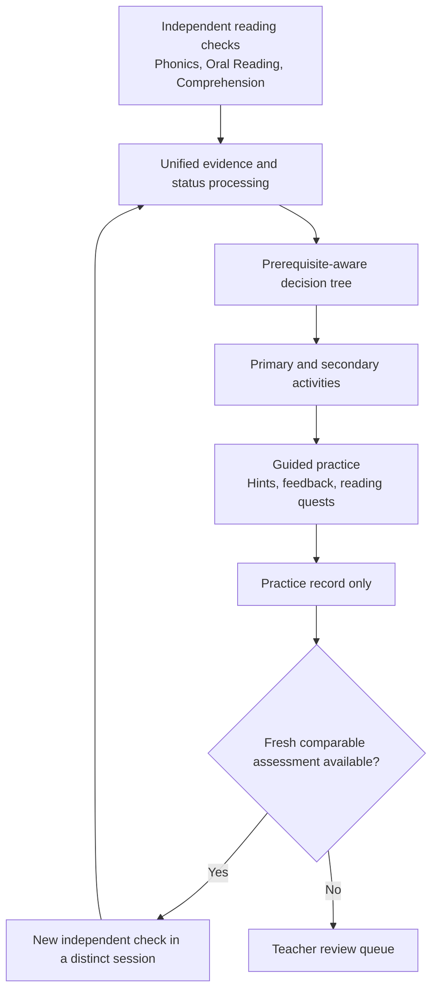

# BasaBridge

**Adaptive, teacher-guided reading support for Grade 3 English learners in Davao City, Philippines.**

BasaBridge is a hackathon-stage educational prototype that connects **skill-specific reading checks** to **explainable learning recommendations**, **guided practice**, and **fresh independent reassessment**. It considers three skills independently: **phonics**, **oral reading accuracy**, and **reading comprehension**.

> [!IMPORTANT]
> **Prototype, not a validated reading diagnostic or production school system.** The project's 80% demonstration cutoff and other status rules are configurable prototype policies—not official DepEd/CRLA reading classifications. Use **fictional learner IDs and consenting adult voices** for demonstrations. Do not expose the current teacher/evidence endpoints publicly or upload identifiable child data without appropriate school approval, privacy controls, and authorization.
>
> **Repository status:** This README was prepared from the available **BasaBridge Enhanced Phase 6 source snapshot (November 15, 2026)**. The newest GitHub branches and deployment have **not** been independently audited. Check the current source and merge history before treating every feature below as present on `main`.

## Quick start — Grade 3 English demo (Windows 11)

The English assessment-and-practice application is in **`litera-reading-checks/`**. It is different from the earlier Filipino prototype in the repository root.

**Requirements:**

- **Windows 11**, with Python **3.11 or 3.12** and Node.js **22.12+** available on `PATH`.
- Internet access for first-time Python/npm dependency installation and the initial `faster-whisper` model download.
- Chrome or Edge; microphone access and a consenting adult speaker for optional recording demonstrations.

1. Clone or download the repository and open the **`litera-reading-checks`** folder.
2. Close any other local demo using port `8765`.
3. Double-click **`Start-Litera.cmd`** and leave the terminal running. The launcher creates a Python environment, installs backend dependencies, and builds the React frontend if a current build is missing.
4. Visit **http://127.0.0.1:8765**.
5. Start a session with a **fictional learner ID**, then try the three reading checks and recommended practice.

PowerShell, from the repository root:

```powershell
cd .\litera-reading-checks
.\Start-Litera.cmd
```

If the launcher fails, read the console error before retrying. For a port conflict, from `litera-reading-checks/` run:

```powershell
.\.venv\Scripts\python.exe -m uvicorn backend.server:app --host 127.0.0.1 --port 8766
```

Then open `http://127.0.0.1:8766`. Browser microphone capture works on localhost or HTTPS; it may require permission and a compatible recording format.

**Do not open the root `dist/index.html` when demonstrating Grade 3 English.** That is the separate, earlier Filipino-reading prototype.

## What the English prototype does

| Area | Snapshot implementation | Important boundary |
| --- | --- | --- |
| **1. Phonics assessment** | Five-word checks, local `faster-whisper` transcription as an advisory signal, audio replay and teacher-confirmed judgments | STT does **not** establish phoneme correctness; teachers decide correctness |
| **2. Oral reading assessment** | Short-passage reading, optional audio capture/transcription/word alignment, teacher review of individual words, accuracy calculation | Alignment is advisory; no validated automatic fluency or pronunciation diagnosis |
| **3. Comprehension assessment** | Original English passages, five questions per check, server-validated answer keys, independent/assisted distinction | Limited provisional forms; not an official reading-level assessment |
| **4. Unified evidence system** | SQLite assessment records, independent skill/tier histories, duplicate checks, status and reassessment handling | Practice events never establish mastery |
| **5. Adaptive decision tree** | Prerequisite-aware recommendations with primary and secondary activities, visible evidence/recheck queues and teacher activity overrides | Not a lowest-raw-score recommender; overrides do not rewrite assessment evidence |
| **6. Guided practice** | Skill-matched content, teacher-authored graduated hints, corrective feedback, practice completion and fresh-check handoff | Practice history remains browser-local in this snapshot |
| **Learning experience** | Private Word Village / Story Forest / Meaning Mountain quests, text-size/high-contrast/focus controls | Quest counts represent practice participation, **not proficiency** |
| **Teacher evidence view** | Localhost demonstration of skill status, stored assessment events, pending reviews and overrides | **No authenticated teacher accounts or API authorization**; not safe for public deployment |

The project also contains a separate browser-local **Filipino reading prototype** with fictional learners, prepared activities, local progress and service-worker caching. Its instructional content and recommendation rules are **not** the same as the Grade 3 English assessment application.

## Learning flow



### Evidence and scoring safeguards

- Phonics, oral reading and comprehension are evaluated **separately**, with raw correct/total counts and their own difficulty tiers.
- The demonstration threshold is **80%**. The inclusive **75–85% initial review band** produces **UNCONFIRMED** rather than an unsupported immediate readiness claim.
- Skill states include **SUPPORT**, **READY**, and **UNCONFIRMED**. A previously established state is not changed by a single surprising result; qualifying independent checks must satisfy the existing freshness, comparability and separate-session rules.
- Missing, assisted, invalid or incomplete evidence must not be interpreted as an independent failure or change a confirmed status.
- The recommendation tree identifies **all active gaps**; its default foundational priority is **phonics → oral reading → comprehension**, while continuing appropriate connected-text and meaning practice.
- A teacher can override **which activity** is recommended, but cannot silently rewrite an original assessment result.
- **Guided practice, hints, retries, XP and completed quests never count as independent evidence of mastery.**

These thresholds and routing policies are **prototype design decisions**, not clinically or educationally validated cutoff scores.

## Example demo walkthrough

1. **Assess:** With a fictional learner and consenting adult audio, complete phonics, oral reading and comprehension checks. Review any proposed speech-transcription matches before submitting teacher judgments.
2. **Inspect evidence:** Review separate scores, statuses, and the primary/secondary recommendation in the current session.
3. **Practice:** Open the recommended activity. Use the three-level teacher-authored hints; observe answer feedback and assistance tracking.
4. **Complete a quest:** Confirm the private reading map updates **participation progress only**.
5. **Reassess:** Select a fresh independent check. If no suitable unseen form is available, the application should request **teacher review** rather than reuse an exposed form.
6. **Teacher review:** On localhost, inspect the evidence view and optionally record a reasoned activity override. Original assessment evidence must remain unchanged.

A demonstration of true status promotion may require synthetic test fixtures because the included assessment-form inventory is small and some forms can be exhausted by prior exposure.

## Repository layout

```text
DavaoLearn-AI/
├── dist/                       # Legacy buildless Filipino reading prototype
├── voice/                      # Earlier voice/testing and decision-tree support
├── phonics/                    # Standalone phonics module/demo
├── litera-reading-checks/     # Grade 3 English integrated assessment demo
│   ├── frontend/              # React, TypeScript and Vite application
│   │   ├── src/               # Assessments, practice, quests and teacher UI
│   │   └── tests/             # Frontend logic tests
│   ├── backend/               # FastAPI, evidence store, forms, speech and planning
│   ├── tests/                 # Python tests
│   ├── Start-Litera.cmd       # Windows launcher
│   ├── EVIDENCE.md            # Scoring and evidence contracts
│   ├── ADAPTIVE-PLAN.md       # Decision tree and recommendation rules
│   ├── PRACTICE.md            # Learning activities and reassessment handoff
│   ├── IMPLEMENTATION-AUDIT.md
│   └── DEVELOPMENT.md        # Setup, regression tests and demo checklist
├── tests/                     # Legacy/integration Python tests
└── README.md
```

*This tree describes the inspected enhanced source archive; directories may differ across remote branches.*

## Development and testing

Run these commands from **`litera-reading-checks/`** after installing Python and Node.js:

```powershell
# Install dependencies, run frontend tests, and build the English UI
npm --prefix frontend ci
npm --prefix frontend test
npm --prefix frontend run build

# Start the application (the launcher also handles backend setup)
.\Start-Litera.cmd
```

After the launcher has created `.venv`, Python regression tests can be run from the **repository root**:

```powershell
$env:PYTHONPATH = 'litera-reading-checks'
.\litera-reading-checks\.venv\Scripts\python.exe -m pip install pytest httpx
.\litera-reading-checks\.venv\Scripts\python.exe -m pytest -q litera-reading-checks\tests tests
```

**Snapshot verification status (November 15, 2026):** The enhancement archive's audit reports **58 Python tests passed, 3 skipped**, plus **9 frontend logic tests** in a temporary harness. A full `npm ci`/React/Vite build, browser visual QA, actual microphone capture, and physical-device tests were **not verified** in that audit. Run the commands above and follow the checklist in [`litera-reading-checks/DEVELOPMENT.md`](litera-reading-checks/DEVELOPMENT.md) before a live demonstration; do not report new tests as passed until executed.

## Storage, privacy and current limitations

- **Assessment evidence:** Local SQLite through the Python backend. **Guided practice/quest history:** Same-browser `localStorage` (not synchronized across devices).
- **Audio:** Recording/replay is transient within the assessment session; the teacher dashboard cannot replay earlier submitted audio because the demo does not persist those clips. Speech processing is local in the documented configuration, after initial model download.
- **Accounts and security:** The teacher view and evidence endpoints lack production authentication/authorization. Keep the server bound to localhost and use fictional data. **Do not deploy publicly as-is.**
- **Educational materials:** Original passages and limited assessment forms are **provisional, not psychometrically calibrated**. Freshness and difficulty-matching controls do not themselves prove form equivalence.
- **Accessibility:** Text-size, contrast and focus controls are implemented in the enhancement snapshot; screen-reader, physical-device and child-usability checks remain necessary.
- **Connectivity:** The English demo can require localhost backend access and does not offer a fully verified offline mobile deployment. The legacy static prototype has separate service-worker caching behavior.
- **Learning effectiveness:** No independent school pilot has established that this software improves Grade 3 literacy outcomes.
- **AgentCore/AI tutor:** Amazon Bedrock AgentCore orchestration, an unrestricted child-facing AI tutor, and large-scale teacher synchronization are **proposed extensions, not verified integrated features**.

## Project roadmap

- [x] Prototype three separate English reading assessment modules in the inspected source snapshot.
- [x] Add unified evidence processing, deterministic recommendation routing and guided practice in the inspected source snapshot.
- [x] Add graduated practice hints, private quests, accessibility controls and a localhost-only teacher evidence view in the **enhancement archive**.
- [ ] Confirm the newest GitHub feature branches contain these changes and reconcile differences with `main`.
- [ ] Run full frontend build, regression tests and real-device/audio accessibility checks on the intended demo machine.
- [ ] Validate content and assessment forms with educators; expand the fresh comparable assessment inventory.
- [ ] Implement production teacher authentication, access controls, data retention and school/privacy review before collecting real student data.
- [ ] Conduct a supervised educational pilot and evaluate independent learning outcomes.
- [ ] Research a constrained, teacher-supervised AI/AgentCore learning support system as a future optional feature.

## Further documentation

- [English demo quick start](litera-reading-checks/README.md)
- [Implementation audit](litera-reading-checks/IMPLEMENTATION-AUDIT.md)
- [Development and Windows test guide](litera-reading-checks/DEVELOPMENT.md)
- [Evidence contract](litera-reading-checks/EVIDENCE.md)
- [Adaptive recommendation rules](litera-reading-checks/ADAPTIVE-PLAN.md)
- [Practice activities and fresh reassessment](litera-reading-checks/PRACTICE.md)
- [Oral reading scoring](litera-reading-checks/ORAL-READING.md)
- [Comprehension check](litera-reading-checks/COMPREHENSION.md)

## Educational research background

- [IES / What Works Clearinghouse — Foundational Skills to Support Students in Kindergarten Through 3rd Grade](https://ies.ed.gov/ncee/wwc/PracticeGuide/21)
- [IES / What Works Clearinghouse — Response to Intervention in Reading](https://ies.ed.gov/ncee/wwc/PracticeGuide/3)
- [IES / What Works Clearinghouse — Improving Reading Comprehension](https://ies.ed.gov/ncee/wwc/PracticeGuide/14)
- [DepEd ARAL-Reading guidance](https://www.deped.gov.ph/wp-content/uploads/DM_s2025_064r.pdf)

These references inform instructional design; they do **not** validate this app's specific thresholds, automatic speech assessment, lesson choices, or effectiveness.

---

**Development principle:** Validated evidence determines recommendations; guided activities provide practice; only fresh, qualifying independent checks can support a confirmed status change. Teachers remain responsible for educational decisions.
